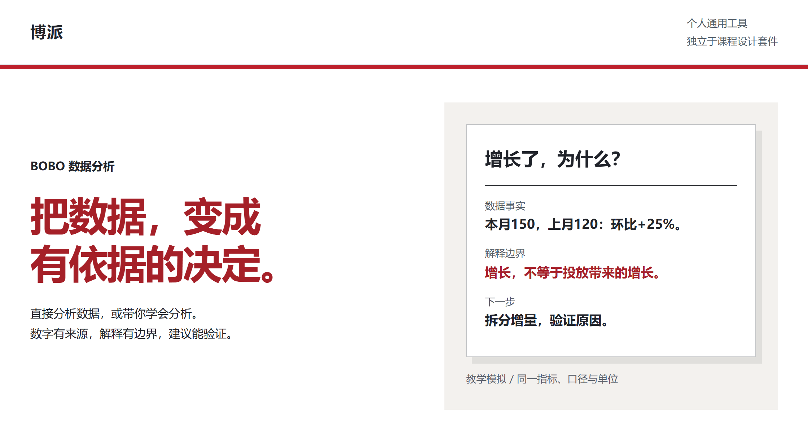

# BOBO Data Analysis｜数据分析 Skill

<picture>
  <source media="(max-width: 600px)" srcset="assets/readme/hero-mobile.png">
  
</picture>

**把数据变成有依据的决定。** 给一份Excel和一个问题，直接计算并解释；想学习时，也能带你理解公式、操作和核验方法。

[安装与开始使用](#安装与开始使用) · [完整使用指南](GUIDE.md) · [课程设计合集](https://github.com/Captainf5/boai-course)

## 先看它如何回答一个问题

**“本月业绩增长了，是不是该增加广告投入？”**

教学模拟：同一指标与单位下，本月150、上月120、去年同月100。

| 分析层次 | 应当得到的内容 |
|---|---|
| 事实 | 环比增长25%，同比增长50%；给出计算式与比较期 |
| 解释边界 | 现有信息不能证明增长由广告带来，也不足以计算利润 |
| 下一步 | 按渠道拆增量，核对活动、客群与成本，再提出验证动作 |

这是一段用于说明方法的模拟样例，不是客户业绩。Skill要求实际读取输入、计算并核查，不能把估算或推测写成已验证结果。

## 你会拿到什么

- **直接执行：**有来源的计算、关键发现、尚未证实的解释和下一步行动。
- **带着学习：**方法解释、Excel实操、可复制的AI提示词与核验办法。
- **按需交付：**Excel分析副本或单文件离线网页报告；小问题不强制生成整份报表。
- **复用经验：**确认过的业务口径与坑位按客户沉淀，同业务下次分析继续复用。

## 两句话就能开始

**要结果：**
> 分析这份营销表的增长来源。请实际计算，区分事实、解释和建议，核对原表后给我简报。

**要学会：**
> 用学习模式教我做同比环比。先讲普通公式，再给AI提示词和实操步骤，最后教我怎么检查结果。

默认使用执行模式；只有明确要求学习、教学或讲解操作时才切换学习模式。

## 安装与开始使用

复制给支持Skill的Agent：

> 请帮我安装 https://github.com/Captainf5/bobo-data-analysis ，保留SKILL.md和references目录，按当前宿主的技能安装方式操作。

也可通过GitHub的 **Code → Download ZIP** 下载完整目录，按宿主要求安装并刷新。无需本Skill专用账号或密钥；执行分析需要宿主具备文件读取与计算能力。命令安装尚未实测，不提供未经验证的一键命令。

[完整使用指南与故障排查](GUIDE.md) · [Skill入口与当前版本](SKILL.md)

数据与能力边界

保留源文件，修改另存副本。Skill没有独立后台，不自行向作者发送数据；输入仍按所用Agent、模型和工具的隐私设置处理。离线HTML不等于模型分析过程离线。

结论取决于数据粒度、口径与质量。缺成本不算实际利润，无订单明细不做购物篮，相关性不当作因果。自动触发、所有操作系统和模型效果均不能仅凭文件检查判定通过。依赖、当前版本说明与验证范围见[完整指南](GUIDE.md)。

本项目未附加开源许可证；公开可见不等于授予任意再分发或商业使用许可。

## 谁适合用

面向个人工作者、学员与讲师的日常数据分析。**bobo-** 是个人通用工具；课程设计请使用独立的 **boai-** [博AI课程合集](https://github.com/Captainf5/boai-course)。

由**冯博 Gatsby / 博派AI**维护，结合企业AI实操培训与日常数据分析场景持续完善。[讲师与项目介绍](https://github.com/Captainf5) · [博派官网](https://www.bopai.online/)。

**问题反馈：**[GitHub Issues](https://github.com/Captainf5/bobo-data-analysis/issues)  
**培训与合作：**[fengbo.football@foxmail.com](mailto:fengbo.football@foxmail.com)

页面设计方法参考 [花叔 huashu-design](https://github.com/alchaincyf/huashu-design)。分析示例明确为教学模拟。

介绍资料：冯博老师简介—2026简约版、[博派官网](https://www.bopai.online/)，核对日期：2026-11-02。课程任务示例与服务经历分开展示。
